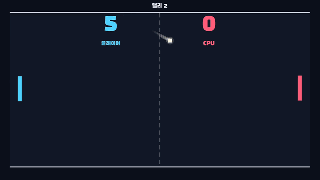

# open-game-works-game-pong

[한국어](README.ko.md)

**Paddle Duel** (`패들 듀얼`, a working title) is a paddle-and-ball arcade game for macOS: one player against the CPU.
AI agents made it with [open-game-works](https://github.com/wnsrn3436/open-game-works-core).

<p align="center"></p>

## Status

The game was made with open-game-works and played and checked on macOS during development. It has not been built for
release yet: the `build` command has not been run on it.

## What it is

You move the left paddle and return a ball that gets a little faster with each hit. Where the ball meets the paddle
sets the angle it goes back at: almost flat from the center, steep from the end. The CPU misses more often as the ball
gets faster and steeper, so points come from a long rally that ends in a shot angled off the end of the paddle. The
first side to reach 7 points wins the match.

The game started from a one-line request to the harness for a simple paddle-and-ball game. `brief.md` keeps that
request under `## request`, with the items the request did not state and the content agent decided. A human picked
the reference game during `setup game`.

| | |
|---|---|
| Players | one player against the CPU |
| Platform | macOS (`settings.json` `buildPlatforms`) |
| Input | keyboard and gamepad |
| Screen | landscape, base resolution 1920x1080 |
| Languages | Korean (source text) and English |
| Client / server | Godot / TypeScript |
| Core version | `0.1.0` (`settings.json` `coreVersion`) |

### A match

1. Serve wait: a dimmed ball waits at the center of the court, and dots and an arrowhead show where the serve will go.
   The paddles can already move. The wait is 1.2 seconds before the first serve and 1 second after a point.
2. Serve: the ball starts toward the side that conceded the last point, slower than a rally ball. The first serve goes
   to the player.
3. Rally: each paddle hit makes the ball faster, up to a top speed. The rally count shows at the top of the screen,
   and match point shows when either side needs one more point.
4. Point: when the ball passes one end of the court, the other side scores. A screen flash, shake and sound mark it,
   and the next serve follows without any input.
5. Match end: at 7 points the result is saved on the server, and the result screen shows the score, the longest rally
   and the record. One press of `다시 하기` (Play again) starts the next match.

A new player sees the terms popup once and goes straight into the first match. Until one match is finished, the game
opens on the match screen; after that it opens on the menu (record, start match, options). The record (wins, losses,
best rally, win streak) is the only thing kept between matches. There are no power-ups, items, currency, shop, ads or
payments, and no two-player mode on one screen.

### Controls

| input | action |
|---|---|
| `W` or `↑`, gamepad D-pad up or left stick up | move the paddle up while held |
| `S` or `↓`, gamepad D-pad down or left stick down | move the paddle down while held |
| `P`, gamepad `Start` | pause during a match |
| `Esc`, gamepad `B` | pause during a match; back on other screens |
| mouse click, `Enter` or `Space`, gamepad `A` | press a UI button (`Enter`, `Space` and `A` press the focused one) |

Holding both directions at once stops the paddle.

### Look and sound

Bright solid-color shapes on a dark navy court. The player paddle is cyan (`#4DD2FF`), the CPU paddle is coral
(`#FF5C7A`), and yellow (`#FFD34D`) marks top ball speed, match point and focus. A paddle hit brings screen shake, a
paddle squash, a contact mark and a short synth sound; a point brings screen shake, a court flash and its own sound.
The ball leaves an afterimage, and wall bounces have their own sound. The menu plays a calm synth loop, and a match
has no music.

## How it works

The client runs the match. The server keeps the record.

```
client/ (Godot)                               server/ (TypeScript)
features/match/sim/match_sim.gd               server core module play-session
  ball, paddles and CPU in integer
  court units, one tick every 10 ms

match start --- StartPlaySession -----------> opens a play session
match end   --- FinishPlaySession ----------> hooks/play_session.ts
                PlaySessionResult               verify_match_result
                (player_score, cpu_score,       apply_match_result
                 longest_rally)
            <-- updated MatchRecordUserState -- wins, losses, best_rally, win_streak
```

- `verify_match_result` accepts a result only when exactly one side has 7 points, the other side has fewer, and the
  longest rally is within `rally_max`. `apply_match_result` adds a win or a loss, updates the win streak and keeps the
  best rally.
- The CPU predicts where the ball will arrive, waits a reaction time, and moves at a limited speed toward that point
  plus an error. The error grows with the speed and steepness of the ball (`design.md` `### CPU`).
- Gameplay values (points to win, tick, paddle and ball speeds, serve delays, CPU reaction and error) are rows of
  `data/system/game_setting.csv`, not constants in code.
- The game defines no requests of its own. `contract/service.proto` holds only `PlaySessionResult`, and
  `contract/user_state.proto` holds `MatchRecordUserState`.
- Core modules the game chose (`settings.json` `coreModules`): client `NativeUiCore`, `TweenCore`, `ScreenEffectCore`,
  `CameraCore`; server `play-session`.

## Made with open-game-works

[open-game-works](https://github.com/wnsrn3436/open-game-works-core) is a harness in which AI agents make server-client
games. The features that games repeat are prebuilt as core, and agents write only the gameplay as content code. A game
is made in a loop: the content agent edits, the play agent plays an instance with real input, the judge agent compares
it with the baseline game and the gameplay video of a reference game, and the harness tool decides success from the
judge results and automated checks. Resource sub-agents make the final resources, and translation sub-agents make the
translations.

`client/core/` and `server/core/` are copies of
[core release v0.1.0](https://github.com/wnsrn3436/open-game-works-core-impl/releases/tag/v0.1.0), and the engine
version comes from that release (Godot 4.7.2). At its start, `update game` raises `coreVersion` to the newest core
release the game can use.

| repository | contents |
|---|---|
| [open-game-works-core](https://github.com/wnsrn3436/open-game-works-core) | the harness: agent rules, skills, module specs, the CLI `ogw` |
| [open-game-works-core-impl](https://github.com/wnsrn3436/open-game-works-core-impl) | the core implementation; core releases are its GitHub Releases |
| open-game-works-game-pong | this game |

## Repository layout

| path | contents |
|---|---|
| `brief.md` | The brief: player fantasy, emotion, memorable moment, genre conventions, prohibitions, failure penalty, prediction, reference game, the request and the items the content agent decided |
| `design.md` | The design doc: core loop, controls, screens, systems (ball and paddle, CPU, match and record), feel and tuning targets, art and audio direction, terms, core usage |
| `play-guide.md` | The play guide that the play agent and the judge agent receive: goal, controls, game flow, input lock windows, fastest start path, play mode per scene |
| `settings.json` | Game settings: core version, engine, core modules, build platforms, languages, resolutions, environments (secret names only), signing, terms documents |
| `contract/` | Contract (protobuf): `service.proto`, `user_state.proto` |
| `data/` | CSV tables (`tables/`), system tables (`system/`, including `game_setting.csv`), translations (`translations/`), glossary (`glossary.csv`), enums and invariants |
| `resource/` | Resources by resource key: app icon, splash, font, BGM, sound effects, scenes, prefabs, tween presets. `resources.csv` lists every resource key, with the method and license of each generated or catalog resource (and the source of the font) |
| `client/` | Godot project. Content code in `boot/`, `common/` and `features/` (`title`, `menu`, `match`), regression tests in `tests/`, DEV code in `dev/` (bot playtest scenario `dev/bot/scenario.json`). `core/` and `generated/` are written by the harness tool. `resource` is a link to `../resource` |
| `server/` | TypeScript server. `main.ts` registers the hooks in `hooks/play_session.ts`, regression tests in `tests/`, DEV code in `dev/`. `core/` and `generated/` are written by the harness tool |
| `records/` | Process records that agents and the tool write (loop iteration records, loop end records, hardening records, core proposals). The repository now holds only `records/setup/reference/reference.md` |
| `LICENSE`, `LICENSES/` | License texts |

The branch `id-registry` holds only the ID registry (`id_registry.json`). Only the data tool writes it, and it is never
merged with another branch. Build artifacts (`builds/`), the data binaries (`client/build/`, `server/build/`), captures
and loop evidence are not committed.

### Languages

Source text is Korean: `settings.json` sets no `sourceLanguage`, so the default `ko` applies, and
`supportedLanguages` is `ko` and `en`. The English text is in `data/translations/en.csv`, and `data/glossary.csv`
fixes the translation of names such as the game title. The documents (`brief.md`, `design.md`, `play-guide.md`,
`reference.md`) are in English and keep the Korean game text in code spans.

## Requirements

- An open-game-works workspace with the harness set up as its
  [README](https://github.com/wnsrn3436/open-game-works-core) describes (Node 24 or later, Git, GitHub CLI, Docker with
  buildx, uv and Python, Claude Code or Codex)
- Godot 4.7.2, the engine version that the core release this game pins names. `update env` installs it into
  `<workspace>/.ogw/`
- To build the macOS app, the only build platform of this game: an Apple silicon Mac with Xcode 27 (named by
  `engine.json` of core release 0.1.0)
- Windows: `client/resource` is a symbolic link. Enable Developer Mode and run `git config --global core.symlinks true`
  before cloning, or the link checks out as a plain text file. The play and judge agents run only on macOS and Linux,
  so the loop and builds do not run on Windows

## Setup

Clone the repository into `games/` of the workspace, and create the local branch `id-registry` from the remote one
(a clone has only `main`, and the data tool reads the ID registry from the local `id-registry`):

```
<workspace>/
  open-game-works-core/
  open-game-works-core-impl/
  games/open-game-works-game-pong/
```

```sh
cd <workspace>
git clone https://github.com/wnsrn3436/open-game-works-game-pong.git games/open-game-works-game-pong
git -C games/open-game-works-game-pong branch id-registry origin/id-registry
```

The folder name is the game name in commands. Then open Claude Code or Codex in `open-game-works-core/` and run
`update env`, which checks the build toolchain of this game and installs the engine of its core version.

### Reference game video

`records/setup/reference/reference.md` records the reference game that a human picked during `setup game`, the source
URL of its gameplay video and the moments of the video that the judge agent compares with. The video file is not in
the repository (`.gitignore` excludes every file in `records/setup/reference/` except `reference.md`), but the judge agent of `update game` needs it.
Before you run the loop, fetch it by running this from `open-game-works-core/` (needs `yt-dlp`):

```sh
tools/bin/ogw game reference open-game-works-game-pong <the YouTube URL in reference.md>
```

This saves it in `records/setup/reference/` as `<video id>.mp4`. Rename that file to the name under `## video` of
`reference.md`.

## Usage

Give these commands in a Claude Code or Codex session opened in `open-game-works-core/`. The agent that receives a
command carries it to the end and reports to you.

| command | what it does |
|---|---|
| `update game: open-game-works-game-pong <request>` | Changes the game through the loop. The request is your feedback or a PROD problem to fix. When the loop stops, the commit the tool picks is merged into main if main has not moved in the meantime, and you get the loop end record |
| `build: open-game-works-game-pong DEV` | Hardens the server and client content code, runs the checks again with PostgreSQL, builds the macOS app into `builds/`, tags the commit `dev-<version>` and deploys the DEV server. Without `--version`, the first build is `0.1.0` |

STG and PROD builds go as far as signed artifacts. STG also deploys its server, and a human deploys PROD.

### Running an instance

An instance is a dev run of the game: one local server with its own DB and a client that draws the screen. `ogw` is
`tools/bin/ogw` of the harness repository. Run it from `open-game-works-core/`:

```sh
tools/bin/ogw instance start open-game-works-game-pong   # prints the instance id and address
tools/bin/ogw instance stop <id>
```

The client logs in with a dev account and starts without the terms popup. The DB is SQLite unless you pass
`--db postgresql`, and `--commit <sha>` starts the instance from another commit. `ogw capture <id>` captures the
screen, `ogw log <id>` shows the error log, and `ogw command <id> list_commands` lists the content commands of the
game.

### Before the first DEV build

Run these from `open-game-works-core/`.

- `settings.json` holds only the names of secrets. The values go into the secret store of your host: generated values
  with `tools/bin/ogw secret generate open-game-works-game-pong DEV`, and the others, such as the deploy SSH key and
  the macOS signing material of `signing.macos`, with
  `tools/bin/ogw secret set open-game-works-game-pong <DEV|signing> <name>`, which reads the value from stdin.
- On a new host, `secret generate` makes a new update signing key and adds its public key to `updatePublicKeys` in
  `settings.json`. Commit that change before the build.
- The server URLs, deploy hosts and host keys, terms document URLs, CDN values and notary IDs in `settings.json` are
  placeholders (`.invalid` hosts, `PLACEHOLDER`). Replace them with your own, and change `serverImage.repository` and
  `appId` to an image repository and an app ID that you control.

## License

| part | license |
|---|---|
| The content of this repository | [CC BY-NC-ND 4.0](https://creativecommons.org/licenses/by-nc-nd/4.0/) (`LICENSE`) |
| `client/core/`, `server/core/` (copies of an open-game-works core release) | Apache-2.0 (`LICENSES/Apache-2.0.txt`) |
| `resource/font/main.ttf` (Black Han Sans) | SIL Open Font License 1.1 (`LICENSES/OFL-1.1-BlackHanSans.txt`) |

`resource/resources.csv` lists every resource key. For the final resources made by a generation method or taken from a
pinned catalog, it also gives the method and license, and for the font the source and attribution. Those resources
are:

| resources | method | license |
|---|---|---|
| `app_icon/main`, `splash/main` | `flux2-klein` | Apache-2.0 |
| `bgm/menu` | `ace-step` | MIT |
| `sfx/*` | `moss-sfx` | Apache-2.0 |
| `font/main` | `font-catalog` | OFL-1.1 |

The license manifest of the game, `client/generated/licenses.json`, lists the third-party components, such as the
Godot Engine, with their licenses and notices.
